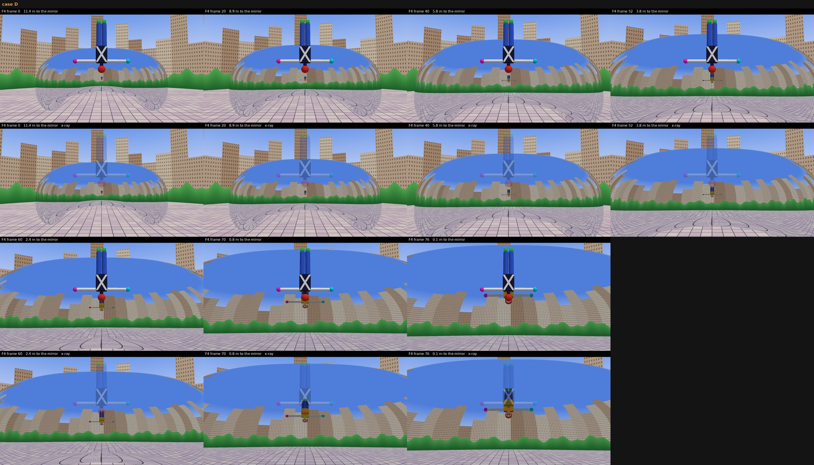

# v10 F4: the Bean reflection, checked in three.js (3:00.02-3:03.56)

Status: done. Two versions built, the EDL swap is below. The lead integrates and renders.

Jade's note (2026-10-18): "it should be her front that is visible in the bean's reflection as she's falling, and in the
reflection her feet should be above. … worth thinking it out in three.js and doing a quick little check of that fall."

## The answer
**In the shot as drawn, with her front to the camera and the Bean behind her, the Bean shows her BACK, with her feet
ABOVE (the same way up as she is).** Her front only shows in the reflection if the mirror is under her and floor-like.
Then her feet point DOWN, which is what v9 did. Front and feet-above together need her to face the Bean, and then the
camera would see her back. So physics agrees with half of Jade's note (feet above) but not the other half (front).

In the drawn geometry (case A below):
- **Where:** just below her crown, on her centre line, where the Bean's front face is close to upright (14 deg from vertical at the
  contact point). Not hidden behind her: the camera is about level with her head, so the mirror point that sees her is
  below her head in the frame.
- **Which side:** her back (the mannequin's dark back with the white X, the red back of the head, no face).
- **Which way up:** feet up, head down, like her. Its feet point at her crown, so the two figures stack nearly feet to head.
  Mirror-reversed left to right, as any reflection is.
- **Size and motion** (1080p, her arm span is about 540 px):

  | F4 src frame | song | to the mirror | reflection (w x h) | of her width / height | top-bottom y (her crown at 608) |
  |---|---|---|---|---|---|
  | 0  | 3:00.02 (f4320) | 11.4 m | 72 x 28 px   | 13% / 5%  | 646-674 |
  | 20 | 3:00.66 (f4335) | 8.9 m  | 90 x 40      | 17% / 8%  | 644-684 |
  | 40 | 3:01.30 (f4351) | 5.8 m  | 132 x 62     | 25% / 12% | 634-696 |
  | 52 | 3:01.69 (f4360) | 3.8 m  | 182 x 94     | 34% / 18% | 608-702 |
  | 60 | 3:01.94 (f4366) | 2.4 m  | 238 x 130    | 44% / 25% (20% of it behind her) | 570-700 |
  | 70 | 3:02.26 (f4374) | 0.8 m  | 368 x 212    | 68% / 41% (44% behind her) | 462-674 |
  | 76 | 3:02.44 (f4378) | 0.15 m | 466 x 264    | 87% / 51% (54% behind her) | 372-636 |

  It starts tiny and flattened: the Bean curves much more top to bottom than side to side, so the image is squashed about
  2.5x vertically. It grows smoothly. Its head stays just under her crown while its feet climb up behind her body.
- **Near the surface:** it grows toward life size and slides up behind her. From about 3:01.9 (src 60) her body hides
  more and more of it. At contact only its arms, shoulders and the back of its head show under her face, and the rest is
  behind her. A near-upright mirror meets her back to back, not face to face.

The cue in the brief checks out. In the drawing the reflected horizon trees sit just under her head, and by src 60-66
they are right beside it. In the check the trees reflect where the Bean's normal is close to horizontal. That is the
wall-like front face her line of sight runs into.

## The three.js check
`tools/sectionF/f4_threejs/` (open `index.html` from any local web server at the repo root. It has a case picker, a distance
slider, normal/x-ray/id views and a frame-0 overlay. Headless renders come from `render.mjs`.)
- **Reflection method: ray tracing (sphere-traced signed distances) in a three.js ShaderMaterial**, not a CubeCamera.
  Every pixel marches the scene. A ray that hits the Bean reflects about the exact normal of the Bean's implicit surface
  and is marched again (up to 3 bounces), so a nearby object's reflection is exact for this curved mirror. Limits: the
  far world (plaza tiles, a ring of trees at 48 m, buildings at 130 m, sky) is analytic. There is no Bean self-shadowing
  and no ground shadow. The lens is a pinhole, while the drawing has a fisheye-like barrel (buildings lean out at the
  edges). The mannequin is rigid.
- **Bean:** a superellipsoid 20 x 13 x 10 m (exponent 2.6) standing on the plaza, with a 7 m x 3.7 m omphalos arch cut
  underneath.
- **Mannequin:** 1.62 m, T-pose, legs together, head down. FRONT: a cream face disc with eyes and mouth, plus a bright
  yellow chest with an orange band. BACK: dark navy with a white X and a red back of the head. Cyan LEFT hand, magenta
  RIGHT hand, green shoes, blue legs.
- **Camera fit (case A):** 5.8 m up, 22 m from the Bean's centre, pitched 4 deg up, 69 deg horizontal lens (focal 1.15
  image heights). Her head is 4.2 m in front of the camera at frame pixel (958, 575), which gives her 535 px size. She moves
  with the camera along its line of sight through her head (the footage keeps her head still while the Bean swells around
  it). Her distance per frame comes from the Bean's width in the F4 matte: the camera's distance goes as 1/width, and
  contact is at about src 77. The fit, with frame 0 overlaid: 
  The Bean's width and the reflected horizon height match. The drawn Bean is a little taller and its arch higher.
- **Cases** (each sheet: top row normal, second row x-ray, where her direct image is drawn at 30% so whatever is behind her
  shows):
  - **A, as drawn** (front face, normal 14 deg above horizontal): back, feet up. 
  - **B, higher camera** (13 m up, 10 deg down, contact on the upper shoulder, normal 67 deg up): back, feet up for most of
    the fall. At about 1 m it flattens edge-on (src ~70), then flips to front with feet DOWN just before contact.
    
  - **C, floor-like** (the keyframe prompt's "from high above", 50 deg down, she drops onto the top, normal 86 deg up):
    front, feet DOWN, seen mostly as the crown of her head and her shoulders. 
  - **D, case A with her facing the Bean:** front with face, feet UP. This is Jade's picture, but the camera then sees
    her back, not her face. 
  - Zoomed crops of all four (cases down, src 0/40/60/70/76 across, normal over x-ray): 
- Numbers per case and frame (bbox, size, how much is hidden behind her): `docs/revisions/v10/f4/threejs/measure.json`.
  Raw renders: `docs/revisions/v10/f4/threejs/raw/`.

How much the answer depends on the uncertain geometry: front or back depends only on whether the mirror point lies behind
her body's plane. For any camera that sees her front with the Bean behind her, it does, except at the very end over an
up-facing surface (B, C). "Feet above" holds while the surface behind her is closer to a wall than a floor. That covers
A, and B until about 1 m out. Case A's sizes are tied to its fit, and the real Bean is rounder, so treat them as ±30%.

## What I built (comp, no video regeneration)
`tools/sectionF/f4_reflection_v10.py` keeps v9's clean-up of the video model's reflection (plates and ring fill,
v9 caches) and draws a new reflection from the check:
1. `f4_threejs/refmap.mjs` renders case A at every source frame's distance (0-80) in a map mode. For each mirror
   pixel, the reflected ray is followed to her body plane and the point it lands on (metres along her left and from head
   to feet) is stored. The maps are in `media/shots/F4/v10_work/maps/`, with the per-frame distance fractions in
   `schedule.json`.
2. A flat picture of her is laid on that plane and sampled through the map. Position, size, the vertical squash, the
   curvature distortion and the mirror reversal all come from the ray tracer. The check frame is matched to the footage
   by her crown (band + 112 px) and her crown-to-soles length.
3. Cooled and darkened like v9 (BGR x [1.0, 0.95, 0.88] x 0.88), at 0.9 opacity, clipped to the Bean matte. It rides the
   ripples from src 70 and fades out over src 72-80 as the mirror goes liquid (v9's timing). Her own pixels go back on
   top, which hides the part of the reflection behind her.

- **BACK (physics):** the picture is a painted back view in the same pose, `media/shots/F4/v10_back/back_3.jpg`. It came
  from `tools/sectionF/f4_back_gen.py`, a nano-banana-pro call with her F4 frame 40 and the outfit sheet as refs: back of
  the head with hair, headphones from behind, the jacket back with the pale-blue circle and "RARE EARTH", pants back
  pockets, sneaker heels, pencil hand on the correct side. It is matted with BiRefNet. In the mirror the "RARE EARTH"
  text reads reversed, as it should.
- **FRONT (Jade's version):** the picture is her own front pixels from the same frame, mirror-reversed, so the
  headphones, face, patch and pencil match by construction. It uses the same place, size and motion as the back
  version, with feet above. This is what she would see if she faced the Bean. Here she faces the camera, so a mirror
  could not show it.

Outputs (1920x1080, 24 fps, 121 frames, CRF 12, timing identical to the source):
- `media/shots/F4/take_2_engraved_dered_v10refl_back.mp4`: physics.
- `media/shots/F4/take_2_engraved_dered_v10refl_front.mp4`: Jade's version.
- `media/shots/F4/take_2_engraved_dered_v10refl.mp4`: a copy of `_back` (the physically right one).

Before/after (rows: v9 now in the cut, v10 BACK, v10 FRONT; labelled with src frame, song m:ss and song frame):
-  (crops round her head, src 0-74)
-  (whole frames)
- Debug strips (source over output, every 6th frame): `docs/revisions/v10/f4/debug_back.jpg`, `debug_front.jpg`.

Rebuild:
```
node tools/sectionF/f4_threejs/render.mjs --out docs/revisions/v10/f4/threejs/raw      # the check (GPU Chrome)
~/Documents/1-music-shipped/moongazing/.venv/bin/python tools/sectionF/f4_threejs/sheets.py docs/revisions/v10/f4/threejs/raw docs/revisions/v10/f4/threejs
tools/engrave/.venv/bin/python tools/sectionF/f4_reflection_v10.py media/shots/F4/take_2_engraved_dered_patch.mp4 \
    media/shots/F4/take_2_engraved_dered_v10refl_back.mp4 --side back      # (--side front for Jade's version)
~/Documents/1-music-shipped/moongazing/.venv/bin/python tools/sectionF/f4_v10_sheets.py
```

## Exact EDL swap (the lead applies it. I didn't edit `F_edl.json`, `edl.py` or any timeline.)
In `media/shots/F_edl.json`, F4 shot, pick one:
```diff
-  "file": "media/shots/F4/take_2_engraved_dered_v9refl.mp4",
+  "file": "media/shots/F4/take_2_engraved_dered_v10refl.mp4",          # = _back, physics
```
or, for Jade's version, `"media/shots/F4/take_2_engraved_dered_v10refl_front.mp4"`. Nothing else changes: in, out,
clip_in, rate, fx and text stay as they are. To survive an `edl.py` rebuild, set the same file in `tools/sectionF/edl.py`
CHOSEN["F4"]. Its `_dered` lookup only adds a suffix when that file exists, and `..._v10refl_dered.mp4` doesn't.

## Weak list (src frame -> song m:ss, song frame = song s x 24)
- **Physics makes it small early.** Up to about src 40 (3:01.30, f4351) the reflection is a small, flat figure under
  her chin: 72 x 28 px at 1080p at src 0, which is 36 x 14 at preview size. It only reads as "her" from about src 50
  (3:01.62). v9's was much bigger. If Jade wants it bigger sooner, that is a stylistic cheat. The check says the real Bean
  would show this little.
- **Lone trees and a gap in the reflected horizon under her, src ~12-36 (3:00.40-3:01.17, f4329-f4348).** v9's Bria
  plates left a gap in the tree line where the old reflection's legs were, with two isolated little trees in it. v9's big
  reflection covered it. The new one is smaller and sits higher, so it shows now. Two automatic refills (row-shift fill,
  tree-band fill) made it worse and were dropped. Fix: re-plate those keyframes (4 x Bria at $0.03), or paint the band.
- **Pale streak down the pink/blue band below her, src ~18-60 (3:00.60-3:01.94, f4334-f4366).** This is the same cause:
  plate fill where the old feet were. It is soft, but it sits on the centre line.
- **The back view is a cleaner drawing than the engraved footage** (flat cel colour, light hatching). It is small and
  tinted until about src 50 (3:01.62). At src 60-70 (3:01.9-3:02.3) it is 250-370 px wide and reads a little smoother than
  her. The jacket back reads pale blue after the chrome tint.
- **The back view is one still.** Her hair moves and its hair doesn't. This only shows from src ~60 (3:01.94, f4366),
  when it is big.
- **The front version, src 60-72 (3:01.9-3:02.3, f4366-4375):** two upside-down copies of her face are stacked one
  under the other (hers, then the reflection's below its shoulders), so it can read as a double. That is the shape of
  Jade's ask in this geometry. Physically it would only happen with her facing the Bean.
- **Ripple and fade, src 70-80 (3:02.26-3:02.58, f4374-4382):** unchanged from v9 (a dissolve into the rings, not a
  splash). v9's dark dent under her chin at src 80-92 is unchanged.
- **Geometry limits:** the drawing isn't a consistent pinhole camera, and the Bean model is approximate. The placement
  follows case A's fit, so the reflection's gap below her crown and its growth rate are good to about ±30%.
- **Not checked:** the engine's 1.0-1.1 zoom, the flashes and the "never stop" text over the new clips. Check them in the
  lead's preview.

## Spend
$0.54: 4 x google/nano-banana-pro at $0.1344 (tag `v10_f4back`). back_1 had four arms, back_2 and back_4 were cropped at
the feet, back_3 is used. The project total is now $398.75 of the $600 cap.
