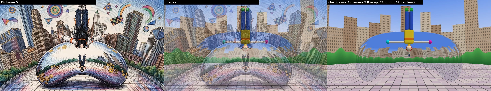
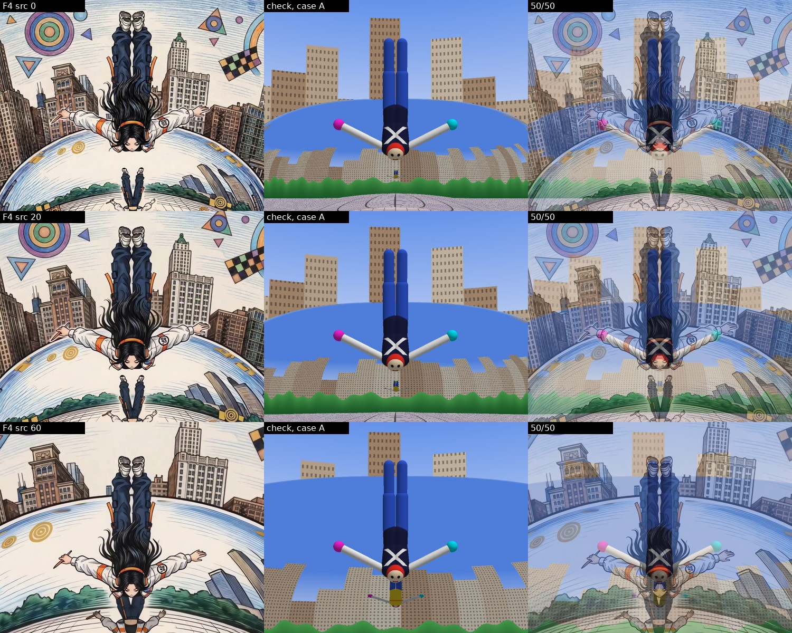
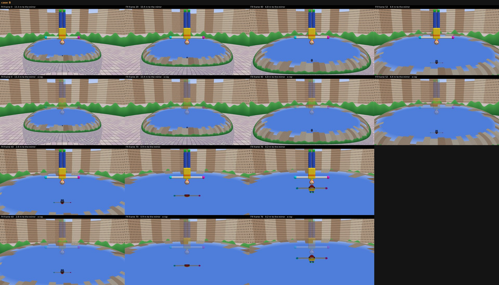
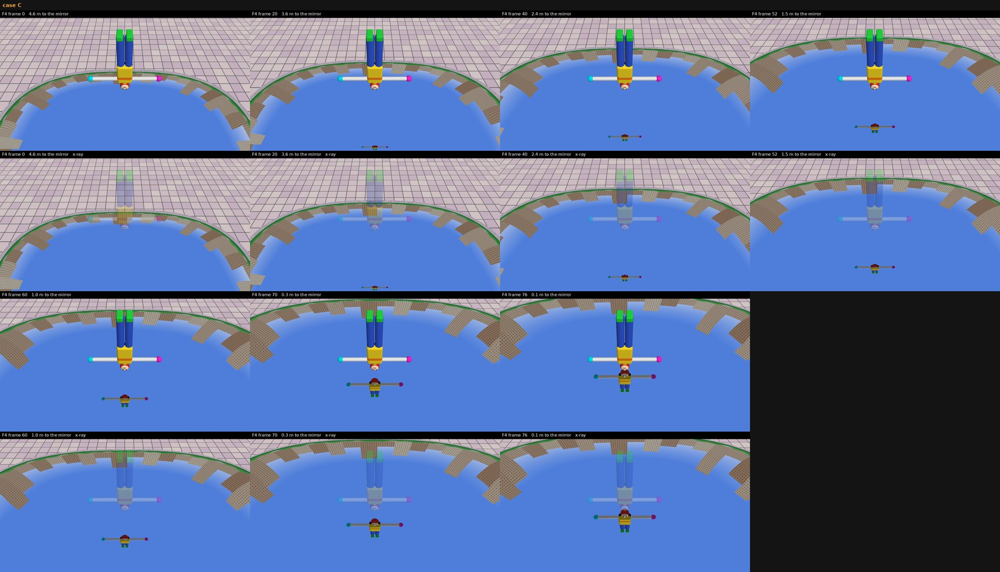
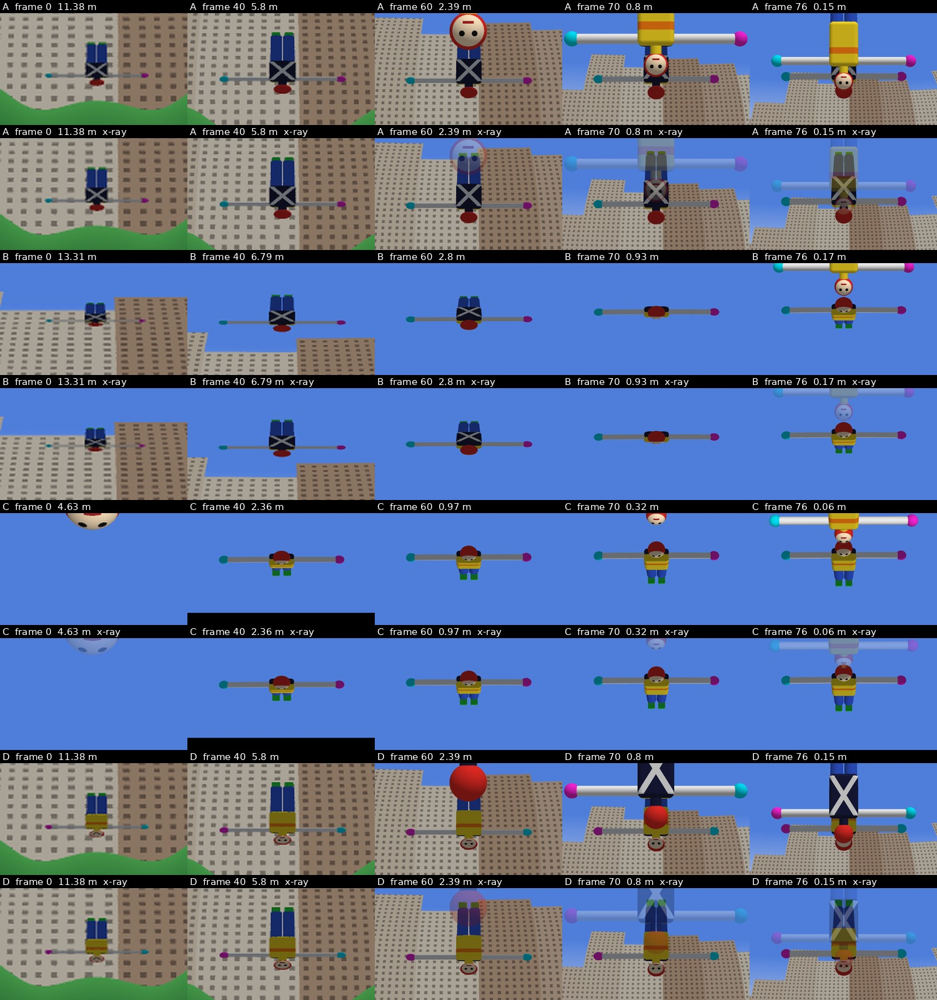
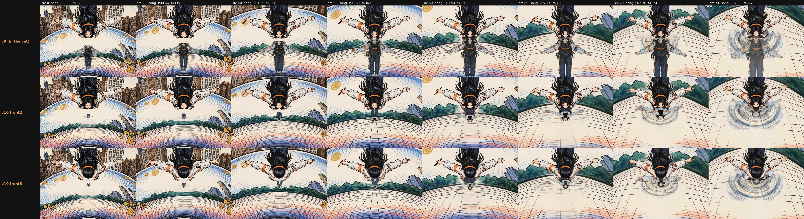
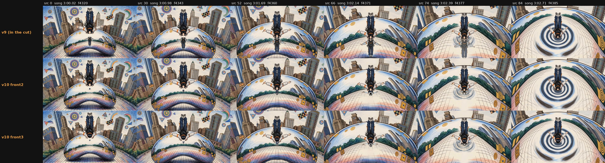
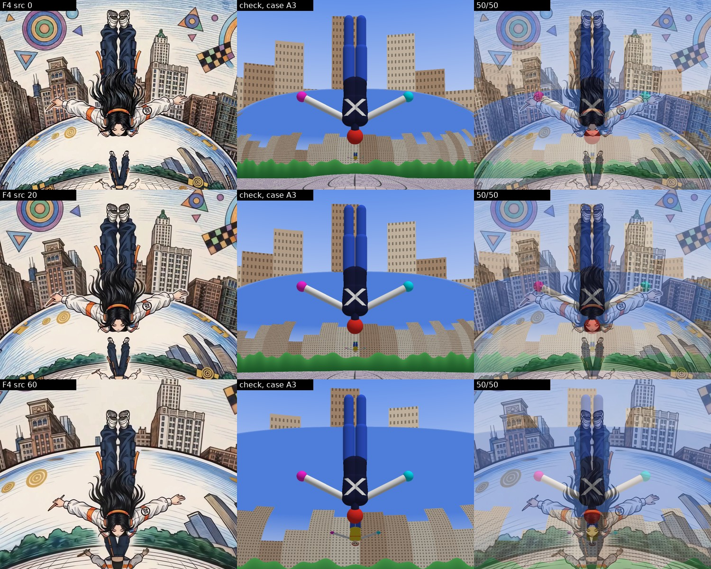
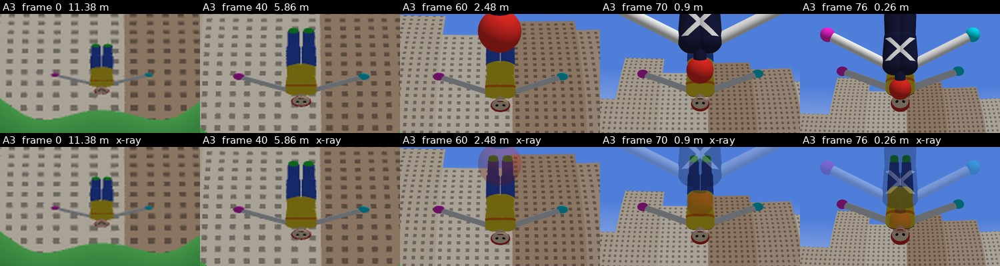
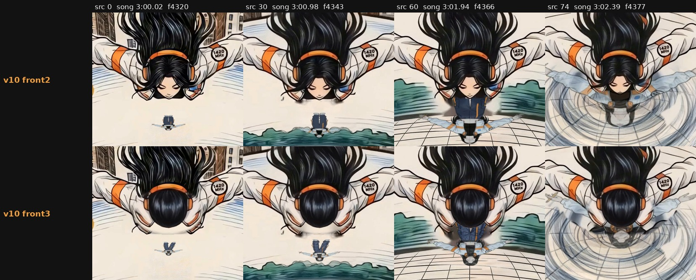

# v10 F4: the Bean reflection, checked in three.js (3:00.02-3:03.56)

Status: done. Two outputs for Jade to choose from: `..._v10refl_front2.mp4` (arched, as drawn) and
`..._v10refl_front3.mp4` (her variant: less arched, the back of her head to the camera, her face in the Bean; see
**front3** below). The EDL swap is below; the lead integrates and renders.

Jade's notes (2026-10-18):
- "it should be her front that is visible in the bean's reflection as she's falling, and in the reflection her feet
  should be above."
- "you're currently looking at her back outside of the bean, it's just that her hair is covering the large pale blue
  dot. you should actually see the front of her jacket and mock neck crop top in the reflection."
- "the reason you can see her face is because her back is arched."

## The answer
**Jade is right on both counts. In F4 the Bean shows her FRONT, with her feet ABOVE (the same way up as she is),
mirror-reversed.**

**My first pass (v10a) was wrong, and so was v9.** Both read her as facing the camera because her face shows at the
bottom of her head. The shot actually shows her back:
- her hair streams up her back and covers the pale-blue dot on the back of her jacket;
- the headphone band crosses the back of her head;
- the orange straps hang on the backs of the cargo pants;
- the 1420 MHz patch is on her left arm as seen from behind.

The face shows because her back is arched and her head is thrown back past horizontal. Her face turns down and back
toward the camera, which is why it reads the right way up (eyes above mouth) under her crown. With her back to the
camera, a wall-like mirror in front of her shows her front. I built v10a's back version on the misread, and it is
withdrawn.

### In the drawn geometry (case A, articulated mannequin)
- **Which side:** her front: jacket front, mock-neck crop top, throat. Her face is turned toward the camera, so the
  mirror sees the underside of her chin and her hair rather than her eyes.
- **Which way up:** feet up, head down, like her. Mirror-reversed left to right: the pencil hand stays on picture-left
  and the 1420 patch on picture-right, on the same sides as her own.
- **Where:** just below her crown, on her centre line. The Bean's face there is close to upright (its normal is 14° above
  horizontal). The camera is about level with her head, so the mirror point that sees her is below her head in frame,
  and the reflection is not hidden behind her.
- **Size and motion** (1080p; her arm span is about 470 px in the check):

  | F4 src frame | song | her head to the mirror | reflection (w x h) | top-bottom y (her crown at 608) | hidden behind her |
  |---|---|---|---|---|---|
  | 0  | 3:00.02 (f4320) | 11.4 m | 66 x 28 px | 646-674 | 0 |
  | 20 | 3:00.66 (f4335) | 8.9 m  | 84 x 40    | 644-684 | 0 |
  | 40 | 3:01.30 (f4351) | 5.9 m  | 120 x 64   | 632-696 | 0 |
  | 52 | 3:01.69 (f4360) | 4.0 m  | 162 x 94   | 608-702 | 0 |
  | 60 | 3:01.94 (f4366) | 2.6 m  | 210 x 130  | 572-702 | 17% |
  | 70 | 3:02.26 (f4374) | 1.1 m  | 316 x 210  | 472-682 | 45% |
  | 76 | 3:02.44 (f4378) | 0.4 m  | 390 x 266  | 390-656 | 58% |

  It starts tiny and flattened: the Bean curves much more top to bottom than side to side, so the image is squashed
  vertically. It grows smoothly. Its head stays just under her crown while its feet climb up behind her body. Near
  contact it is nearly life size and more than half hidden behind her: her belly leads into the mirror, and the
  reflection's front meets hers.

The brief's cue checks out. The horizon trees reflect just under her head (and beside it by src 60-66) because the
Bean's normal there is close to horizontal: the wall-like front face that her line of sight runs into.

## The three.js check
`tools/sectionF/f4_threejs/`. Open `index.html` from any local web server at the repo root; it has a case picker, a
distance slider, normal/x-ray/id views and a frame-0 overlay. Headless renders come from `render.mjs`.
- **Reflection method: ray tracing (sphere-traced signed distances) in a three.js ShaderMaterial**, not a CubeCamera.
  Each pixel marches the scene. A ray that hits the Bean reflects about the exact normal of the Bean's implicit surface
  and is marched again (up to 3 bounces), so a nearby figure's reflection is exact for this curved mirror.
  - Limits: the far world (plaza tiles, a ring of trees at 48 m, buildings at 130 m, sky) is analytic. There are no
    shadows. The lens is a pinhole, while the drawing has a fisheye-like barrel.
- **Bean:** a superellipsoid 20 x 13 x 10 m (exponent 2.6) standing on the plaza, with a 7 m x 3.7 m omphalos arch cut
  underneath.
- **Mannequin (v10b, articulated):** joints at the pelvis, waist, shoulders, neck and head, plus hips, knees and ankles
  (`body()` / `ARCH` in `cases.js`).
  - She is back to the camera and head-first. Her spine extends 5°/10° (belly/chest), her neck 25°, and her head 100°
    more, so it is thrown back 140° in all and the face turns down and back toward the camera.
  - Her legs bow back 6°+6°. Her arms are out in a T, swept 22° toward her feet.
  - FRONT: cream face disc with eyes toward the crown, cream throat, yellow chest with an orange band, yellow belly.
    BACK: navy with a white X, and a red back of the head. Cyan LEFT hand, magenta RIGHT hand, blue legs, green shoes.
- **Camera fit (case A):** 5.8 m up, 22 m from the Bean's centre, pitched 4° up, 69° horizontal lens.
  - Her head is 4.2 m out at frame pixel (958, 575). She moves with the camera along its line of sight (the footage
    keeps her head still while the Bean swells round it).
  - Her distance per frame comes from the Bean's width in the F4 matte (camera distance goes as 1/width); contact is at
    about src 77.
  - Bean fit, frame 0 overlaid: 
- **Pose fit**, src 0/20/60 next to the mannequin from the same camera, and 50/50:
  
  - The face shows under the crown the right way up, the head is at the bottom, the arms rise toward the feet and the
    pencil (right) hand is on picture-left, as in the drawing.
  - The drawn neck is longer than anatomy allows. I gave the mannequin a 16 cm neck to match it.
- **Cases** (each sheet: top row normal, second row x-ray, where her direct image is drawn at 30% so whatever is behind her
  shows):
  - **A, as drawn** (front face, normal 14° up): front, feet up. 
  - **B, higher camera** (13 m up, 10° down, contact on the upper shoulder, normal 67° up): front, feet up for most of
    the fall. It flattens edge-on at about 1 m (src ~70) and turns feet-down just before contact.
    
  - **C, floor-like** ("from high above", 50° down, she drops onto the top, normal 86° up): front, feet down.
    
  - Zoomed crops (cases down; src 0/40/60/70/76 across; normal over x-ray): 
- Numbers per case and frame are in `docs/revisions/v10/f4/threejs/measure.json`. Raw renders are in `.../threejs/raw/`.

How much depends on the uncertain geometry:
- **Front or back:** that she shows her front only needs the mirror to lie on her front side, which holds in every case.
- **Feet above:** holds while the surface in front of her is more wall than floor. That covers A, and B until about 1 m
  out.
- **Sizes:** tied to case A's fit and an approximate Bean, so treat them as ±30%.

## What I built (comp, no video regeneration)
`tools/sectionF/f4_reflection_v10.py` keeps v9's clean-up of the video model's reflection and draws a new reflection
from the check.
1. **The plane.** `cases.js mirrorView()` finds what the mirror sees of her: the camera ray whose reflection passes
   through the middle of her torso (at src 60, the view runs from 16° below her toward her front). A plane through
   her torso faces that view.
2. **The maps.** `refmap.mjs` renders case A at every source frame's distance (0-80) in a map mode: for each mirror
   pixel, the point on that plane its reflected ray lands on. The maps are in `media/shots/F4/v10b_work/maps/`.
3. **The painting.** `refmap.mjs --ref` renders the articulated mannequin orthographically along that view, which is
   the pose the mirror sees (`media/shots/F4/v10_front/pose_ref_mirror_view.png`). `tools/sectionF/f4_front_gen.py`
   painted her in that pose with nano-banana-pro (refs: that pose turned upright, the outfit sheet, her F4 frame 40).
   - `front_2.jpg` is used: head thrown back, chin and throat up, black mock-neck crop top under the open white
     jacket, orange bands, pale-blue dot on her left chest, 1420 MHz on her LEFT sleeve, orange headphones, cargo pants
     with orange straps, white sneakers, hair falling behind her, pencil in her right hand.
   - Checked: two arms, two legs, patch and pencil on the right sides. `front_3` had the pencil in the wrong hand.
4. **The comp.** The painting is turned head-down, matted with BiRefNet, fitted to the pose reference by its box, and
   sampled through the maps. Position, size, squash, curvature distortion and mirror reversal all come from the ray
   tracer.
   - It is cooled and darkened like v9 (BGR x [1.0, 0.95, 0.88] x 0.88), at 0.9 opacity, clipped to the Bean matte.
   - It rides the ripples from src 70 and fades out over src 72-80 (v9's timing).
   - Her own pixels go back on top.
5. **Re-plates** (`tools/sectionF/f4_replate_v10.py`; Bria fibo-edit-1.5 on v9's clean composite). v9's hole is grown
   60 px, plus a column down the pink band for the video model's glow.
   - Re-plated keyframes 12-68 (every 4) into `media/shots/F4/v10b_plates/`. Its `chosen.json` keeps v9's plates for
     0-8 and 72-79.
   - Bria kept painting a reflected head when her head was in the crop, so keyframes 56-68 use a crop that starts under
     her head.
   - The gap in the reflected tree line with two lone trees (src ~12-36) and the pale streak down the pink band
     (src ~18-60) are gone.

Output: `media/shots/F4/take_2_engraved_dered_v10refl_front2.mp4` (1920x1080, 24 fps, 121 frames, CRF 12, timing
identical to the source).

Before/after (rows: v9 in the cut, v10 front2, v10 front3; labelled with src frame, song m:ss and song frame):
-  (crops round her head, src 0-74)
-  (whole frames)
- Debug strip (source over output, every 6th frame): `docs/revisions/v10/f4/debug_front2.jpg`

Rebuild:
```
node tools/sectionF/f4_threejs/render.mjs --out docs/revisions/v10/f4/threejs/raw            # the check (GPU Chrome)
~/Documents/1-music-shipped/moongazing/.venv/bin/python tools/sectionF/f4_threejs/sheets.py docs/revisions/v10/f4/threejs/raw docs/revisions/v10/f4/threejs
~/Documents/1-music-shipped/moongazing/.venv/bin/python tools/sectionF/f4_threejs/posefit.py docs/revisions/v10/f4/threejs/raw docs/revisions/v10/f4/threejs/posefit_caseA.jpg
tools/engrave/.venv/bin/python tools/sectionF/f4_reflection_v10.py media/shots/F4/take_2_engraved_dered_patch.mp4 \
    media/shots/F4/take_2_engraved_dered_v10refl_front2.mp4                     # makes the maps on first run
tools/engrave/.venv/bin/python tools/sectionF/f4_reflection_v10.py media/shots/F4/take_2_engraved_dered_patch.mp4 \
    media/shots/F4/take_2_engraved_dered_v10refl_front3.mp4 --variant front3
~/Documents/1-music-shipped/moongazing/.venv/bin/python tools/sectionF/f4_v10_sheets.py
```

Withdrawn (v10a, built on the misread and deleted): `_v10refl.mp4`, `_v10refl_back.mp4`, `_v10refl_front.mp4`.
The back painting `media/shots/F4/v10_back/back_3.jpg` is unused.

## front3: less arched, her face in the reflection (Jade 2026-10-18)
Jade: "can you try a version where her back is less arched and we see her face in the reflection (and the back of her
head in the nonreflected version)?"

### Three.js
Case `A3` (`ARCH3` in `cases.js`): the same camera, path and per-frame distances as case A.
- Her back is barely arched (2°/3°), her neck straight, and her head tucked 8°. Her legs bow 2°+2° and her arms are as
  before.
- The camera now sees the BACK of her head: red, no face.
- The Bean shows her FRONT with her FACE, mirror-reversed, feet above, head down. The face is upside down in the frame:
  her eyes sit on the crown side (lower) and her mouth above.
- It is seen nearly face-on: the mirror looks up at her from 18° below her front (`mirrorView`: view (0, 0.31, -0.95)
  in her frame), so it is only slightly foreshortened.
- Sheets:
  - pose fit: 
  - case `A3` with x-ray: 
  - zoom: 
  - numbers: `docs/revisions/v10/f4/threejs/front3/measure.json`
- The mannequin's torso is longer in the frame now (head not thrown back), so its shoulders sit higher than the drawn
  ones. **The drawn body still reads arched**, because I only repainted her head, not her torso and legs (as asked).
- Reflection size (1080p, her crown at 608):

  | src | song | reflection (w x h) | y | hidden behind her |
  |---|---|---|---|---|
  | 0  | 3:00.02 (f4320) | 66 x 32  | 642-674 | 0 |
  | 40 | 3:01.30 (f4351) | 118 x 68 | 628-696 | 0 |
  | 52 | 3:01.69 (f4360) | 162 x 100 | 602-702 | 4% |
  | 60 | 3:01.94 (f4366) | 210 x 138 | 562-700 | 23% |
  | 70 | 3:02.26 (f4374) | 316 x 224 | 454-678 | 48% |
  | 76 | 3:02.44 (f4378) | 392 x 274 | 370-644 | 58% |

  Her face in the reflection is about 1/7 of the reflection's height: about 10 px tall at src 40, 20 px at src 60 and
  32 px at src 70 (1080p).

### The camera's view: the back of her head (`f4_reflection_v10.py --variant front3`)
- **The paint.** One nano-banana-pro edit (`tools/sectionF/f4_head_gen.py`) of a 400 px crop round her head at src 30.
  It replaced the face with the back of her head: glossy black hair, the orange band across it, and both ear cups.
  `head_2.png` is used.
- **The tracking.** The painted head rides the headphone band track (her head only translates in this shot). It is
  shrunk to 93% across and 82% down from the band, so the crown sits about band + 104 instead of the chin's band + 112:
  a head seen from behind, a little smaller than the drawn face.
- **The compositing.** It is pasted inside a feathered oval round her old face, hair framing and ear cups. Her own band,
  hair above it, sleeves and collar points stay hers. Where the old face stuck out beyond the new crown, the mirror is
  inpainted from round her head.
- It is one still, so it can't boil. It only goes where her matte says she still is, so it sinks with her into the
  liquid mirror from about src 78.
- 1:1 before/after (front2's drawn face over front3's painted head, src 0/30/60/74):
  

### The reflection: her front with her face
- **The pose reference.** The check renders case A3 orthographically from the mirror's view
  (`media/shots/F4/v10_front3/pose_ref_mirror_view.png`).
- **The painting.** `f4_front_gen.py --pose front3` painted her in that pose: face toward us, eyes gently closed, jacket
  front, mock-neck crop top, headphones, the 1420 patch on her LEFT sleeve, pencil in her right hand, cargo pants with
  straps, sneakers.
  - `front3_1.png` is used: two arms, two legs, sides correct, colored-pencil hatching closest to the footage.
  - `front3_2` had the pencil in the wrong hand.
- **The comp.** The same ray-traced mapping as front2 (maps in `media/shots/F4/v10c_work/maps/`): mirror-reversed,
  feet up, the same squash, ripple and fade. Its crown is aligned to the new painted crown.
- **When the face reads.** It is upside down in the frame. It reads as a face (closed eyes, mouth) from about src 62-66
  (3:02.0-3:02.1, f4368-4371) at 1080p, and it is plain by src 70. At src 50-60 it is a small light oval under the
  reflection's hair.
- The plates are the v10b re-plates, unchanged.

Output: `media/shots/F4/take_2_engraved_dered_v10refl_front3.mp4` (1920x1080, 24 fps, 121 frames, same timing).
- Sheets (v9 | front2 | front3): `f4/before_after_detail.jpg`, `f4/before_after_full.jpg`
- Debug strip: `f4/debug_front3.jpg`
- Two-up video (front2 | front3, the same 1100x900 crop at (410, 180) scaled to 880x720 as the v9-vs-front2 one):
  `deliverables/wip/f4_reflection_front2_vs_front3.mp4`

front3 weak spots:
- **Arched body.** The body still reads arched (only the head changed), so a straight-backed girl in the mirror sits
  under an arched-looking one.
- **Head style.** The painted head is a smoother, glossier drawing than the engraved hair round it, which shows at 1:1.
  It does not move with the hair strands next to it, but those barely move.
- **Grey smudge around src 30** (3:00.98, f4343): a faint smudge either side of the new crown where the inpaint meets
  the collar points.
- **Small face early.** Before src 62 the face in the reflection is too small to read as a face.
- **Ghost hands, front2 and front3, src 64-72** (3:02.07-3:02.33, f4369-4375): faint ghost hands either side of the
  reflection's hands. They are leftovers of the video model's own reflection's hands, which v9's big reflection used to
  cover.

## Exact EDL swap (the lead applies it; I didn't edit `F_edl.json`, `edl.py` or any timeline)
In `media/shots/F_edl.json`, F4 shot, whichever Jade picks:
```diff
-  "file": "media/shots/F4/take_2_engraved_dered_v9refl.mp4",
+  "file": "media/shots/F4/take_2_engraved_dered_v10refl_front2.mp4",     # arched, as drawn
+  "file": "media/shots/F4/take_2_engraved_dered_v10refl_front3.mp4",     # or: less arched, her face in the Bean
```
Nothing else changes: in, out, clip_in, rate, fx and text stay as they are. To survive an `edl.py` rebuild, set the same
file in `tools/sectionF/edl.py` CHOSEN["F4"]. Its `_dered` lookup only adds a suffix when that file exists, and
`..._front2_dered.mp4` / `..._front3_dered.mp4` don't.

## Weak list (src frame -> song m:ss; song frame = song s x 24)
- **Small early.** Up to about src 40 (3:01.30, f4351) the reflection is a small, flat figure under her chin: 66 x 28 px
  at 1080p at src 0, which is 33 x 14 at preview size. It reads as "her" from about src 50 (3:01.62). v9's was much
  bigger. A bigger one sooner would be a stylistic cheat.
- **The painting is a cleaner drawing than the engraved footage** (flat cel colour, light hatching), and its hair is a
  still. Both show from src ~60 (3:01.94, f4366), when it is 200-300 px wide. After the chrome tint the white jacket
  reads pale blue.
- **Flat picture on a plane.** The mapping treats her as a flat picture facing the mirror, so near contact
  (src 70-77, 3:02.26-3:02.49) the arched body's depth isn't in the warp. The ripples and fade cover most of it.
- **Re-plate seams.** Re-plated keyframes differ a little from each other and are cross-faded between keys, so the
  tile lines in the patched column can shimmer slightly at src 12-68 when frame-stepping. At src 69-72 (3:02.23-3:02.33)
  the plates hand back to v9's, and a faint glow returns in the pink band just before the ripples.
- **Ripple and fade, src 70-80 (3:02.26-3:02.58, f4374-4382):** unchanged from v9. It is a dissolve into the rings, not
  a splash. v9's dark dent under her chin at src 80-92 is also unchanged.
- **Geometry limits:** the drawing isn't a consistent pinhole camera, the Bean model is approximate, and the drawn neck
  is longer than anatomy allows. Placement and growth follow case A's fit to about ±30%.
- **Not checked:** the engine's 1.0-1.1 zoom, the flashes and the "never stop" text over the new clip. Check them in the
  lead's preview.

## Spend
- v10a back painting: $0.54 (4 x nano-banana-pro, tag `v10_f4back`). Now unused.
- v10b front painting: $0.40 (3 x nano-banana-pro, tag `v10b_f4front`).
- v10b re-plates: $1.02 (34 x Bria fibo-edit-1.5 at $0.03, tag `v10b_f4plate`). This includes retries: the first
  instruction painted big trees, and keyframes 56-68 kept painting a reflected head or blobs.
- front3: $0.67 (3 x nano-banana-pro for the front painting, tag `v10c_f4front3`; 2 x nano-banana-pro for the back of
  her head, tag `v10c_f4head`).
- Total v10: $2.63. The project is at $400.85 of the $600 cap.
