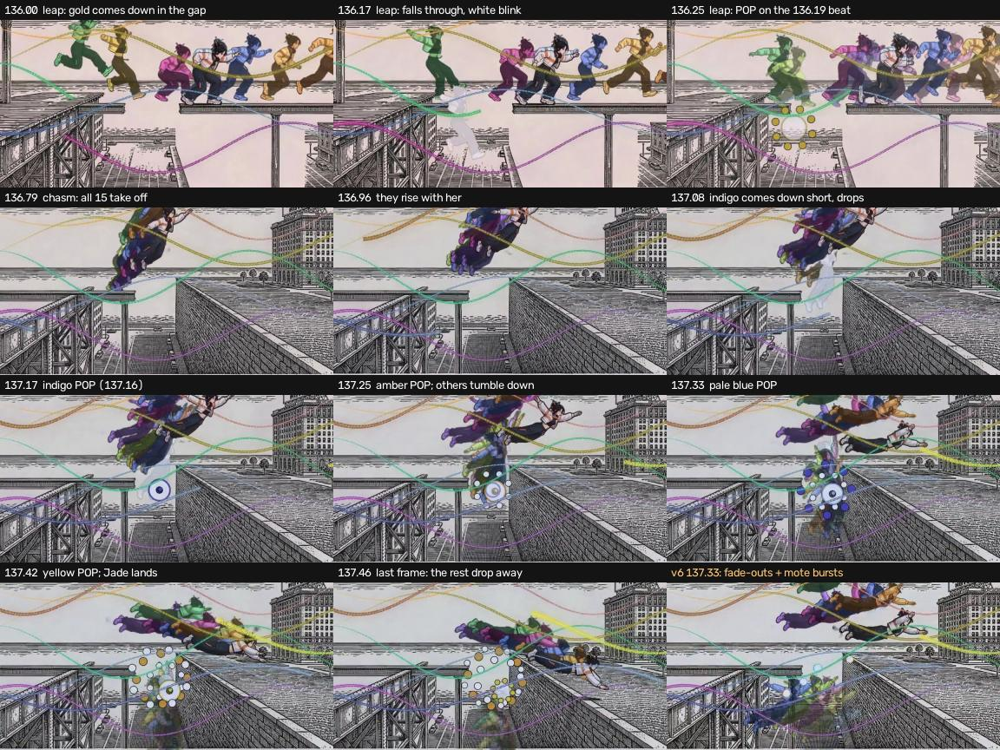
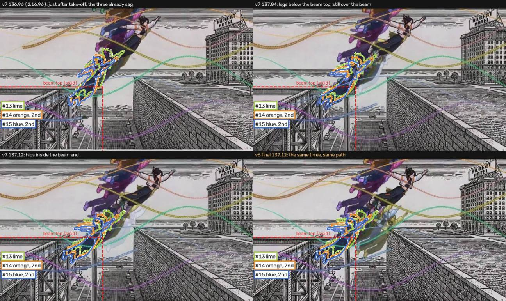

# v7: ghosts that miss pop (2:16–2:17)

Jade on the v6 cut: "Visual logic consistency: 2:16 - perhaps some of the ghosts whose feet didn't land on the beam
should fall through and not make it ('pop' Celeste style)".

Jade's decisions since (2026-10-13/14):
- **Chasm (E7_04, 136.62–137.50):** every airborne ghost from v6 goes back in, gold and lime included. A ghost that
  comes down in the gap falls through it before it pops.
- **The three ghosts that sank through the beam** (lime, the 2nd orange, the 2nd blue): use the gravity curve. They
  rise with the swarm and fall into the gap clear of the beam end.
- **Pops:** about four readable pops in the chasm, not ten. The others drop out of the gap as in v6. Nothing passes
  through the beam or the wall.
- **Kept as they are:** the blue/gold swap in the leap (the survivors stay consistent), gold and lime dying twice, and
  everything else in the leap.
- **No pop sounds:** the film keeps the v6 mix.

`ghost_pop_sheet.jpg` (280 KB): row 1 is the leap, rows 2–4 the chasm. The last tile is v6 at 137.33, for comparison.

## Preview

**`render/engine/out/rewind/rewind_preview_133.00-140.00.mp4`**: 960×540, 133–140, with the film's mix
(`media/sfx/Rewind_cinematic_sfx_mix_v5coda.mp3`). It was rendered with `--audio` set to that mix.
A copy is at `render/engine/out/rewind/ghostpop/ghostpop_v7c_preview_133-140.mp4`; the shared preview path gets
overwritten by other renders. Nothing was rendered at 1080p, and nothing is committed.

## One death, both shots

`fall_pop()` in `tools/sections/D/build_timeline.py` handles every miss:
- From the frame before the miss, the ghost is frozen in that pose and falls: a knock-back vx, its own descent speed
  (at least 250 px/s) and g 9000 px/s².
- **A popper** falls for 5 frames. It blinks white for the last 2 (the same freeze, colorize white, lift #d6d6d6), as
  Celeste's dead body flashes before it bursts. Then it pops at its centroid.
- **A dropper** (chasm only) falls until the cut with v6's fade, with no blink and no pop.
- **In the chasm the falling body also tumbles** toward upright about its own centroid, over 0.17 s. The engine
  rotates a layer about the frame centre, so the builder compensates x and y.

The pop is `render/engine/modules/ghostpop.js`, modelled on Celeste's DeathEffect:
- **Hit flash:** a white disc with a 7 px rim in the ghost's colour and an ink hairline.
- **Orbs:** eight ink-outlined orbs open in a ring that turns a quarter-turn. They swell, then shrink to nothing,
  flickering between colour and white every 2 frames.
- **Size:** in the leap, ring radius 220 px and orb radius 30 px. In the chasm, 170 px and 24 px, with a 60 px hit
  disc.
- **Duration:** 0.36 s.

## E7_02_leap (135.76–136.62), unchanged since the first v7 pass

The take's set is a side-on platformer gap. The girder she jumps from ends at **x 720**, the beam starts at **x 1030**,
and both are at y ≈ 598 (design px). Canon Jade lands with her feet at x 1036–1165, only just on the beam.

Each doubling copy is her clip shifted by slot × 75 px and slot × 2 frames, so any copy 4+ slots behind her lands in
the gap.

| Copy (v6 hue) | Slot | v6 | Evidence | v7 |
|---|---|---|---|---|
| 1 (blue) | −4 | lands on air at 136.01, stands in the gap to the cut | feet x 736–973, never over the beam | **gold** now; falls, pops at 136.18 (on the 136.19 beat) |
| 9 (violet) | −3 | born on copy 1 at 136.19, in the gap until 136.47 | centroid 894–1019 | **never born**: a dead ghost doesn't double |
| 13 (lime) | −5 | born on the girder's lip, peels into the gap | centroid 733→869, heel on the lip | slips off, pops at 136.47 |
| 3 (gold) | +2 | on the beam | | **blue** now: BLUE, the co-op partner, makes it (kept, Jade) |
| 15 (blue) | +1 | on the beam | | **violet** now, so all five chasm survivors are on the beam at the cut |
| 5 (green) | −6 | short jump, ends on the girder's lip | back foot on the girder throughout | lives |
| 4 (magenta) | −2 | peels back to the edge | front foot ~90 px onto the beam | lives |

In v6, copies 2 and 10 ran past source 2.21 s, where the agents enter the take's matte, so a teal agent stood at the
left at 136.54. Copies now end at source 2.15 s.

## E7_04_chasm (136.62–137.50)

### What counts as solid

There are two solid edges:
- **The beam:** top at y 597, ending at x 780.
- **The far wall's near top edge:** from the corner at (1010, 520), running down-right at slope 0.62. Canon Jade's
  feet land at y 733 where the edge is at 738, which confirms the line.

The brick face below that edge is the near side of a cliff facing the gap. A ghost wholly below the edge is falling in
front of the face, which is open air.

A silhouette counts as passing through:
- **the beam**, if any part of it is more than 15 px below the beam top while over the beam;
- **the wall**, if it straddles the wall's edge right of x 1010.

The builder runs this test on every copy's matte silhouette on every frame. The build fails if any flight or fall
breaks it, survivors included.

### What was wrong in v6

All ten non-survivors sagged linearly from frame 0 (y + A·u). The copies run 0.02k s behind her in her clip, so they
are still standing on the beam when the sag starts. Their feet went into the beam at take-off, and the back three sank
through the beam end (`ghost_sink_13-15.jpg`):

Violet, the one survivor that flies lower than her, also dipped into the beam for 3 frames at take-off.

### v7: the gravity curve (all ten non-survivors, not only the three)

Each copy's sag now starts at its own take-off (her source 1.35 s) and follows a gravity curve, y + A·s^p. That
means they rise with the swarm and then drop away faster and faster. Drift-back is −D·u as in v6. The three that sank
needed it most, but the linear sag put every one of the ten into the beam at take-off, so the curve applies to all.
Violet's dip now also starts at her own take-off.

A copy misses at the first frame it is coming down with its feet below the ledge. From the frame before, it freezes
and falls, tumbling toward upright. The builder uses the first tumble and knock-back whose whole fall passes the
solidity test.

Per-copy settings (p, D and A as multiples of v6's values) are in `CH` in the builder. They were chosen to:
- keep each copy close to its v6 arc;
- put the four pops two frames apart (137.16, 137.25, 137.33, 137.41);
- give the pops four contrasting hues, avoiding gold and lime (which already died in the leap) and the second orange
  and blue (which would read as Jade or her co-op partner).

| Copy | Hue | Sag p, ×D, ×A | Comes down short | Fate |
|---|---|---|---|---|
| 1, 2, 4, 5, 9 | orange, blue, magenta, green, violet | (v6 arcs) | | land with canon Jade |
| 12 | indigo | 1.5, 0.3, 2.0 | 137.00 | falls from 136.95, tumbles −30°, **pops 137.16** |
| 6 | amber | 1.5, 1.0, 2.0 | 137.08 | falls from 137.04, tumbles −30°, **pops 137.25** |
| 7 | pale blue | 2.0, 1.0, 1.5 | 137.16 | falls from 137.12, tumbles −50°, **pops 137.33** |
| 8 | yellow | 2.0, 1.0, 1.0 | 137.25 | falls from 137.20, tumbles −70°, **pops 137.41** |
| 14, 15 | orange (2nd), blue (2nd) | 2.0, 0.3, 1.0 | 137.16 | drop out of the gap from 137.12 |
| 10, 11, 13 | teal, pink, lime | 2.0, 0.6, 1.0 | 137.20 | drop out of the gap from 137.16 |
| 3 | gold | 2.0, 2.0, 1.25 | 137.25 | drops out of the gap from 137.20 |

Every miss is over the gap (centroids x 874–943). Canon Jade lands at about 137.42 with the five survivors behind
her.

What changed against v6:
- the stream no longer drags along the beam at take-off; the swarm lifts off as one stack and the misses peel away
  downward;
- the v6 mote bursts on the wall face are gone, as are all drops through the beam end.

**Continuity (kept on purpose):** gold and lime pop in the leap at 136.18 and 136.47, then fly again in the chasm and
drop out of the gap.

### E2_04_leap (114.905–115.24)

E2_04_leap uses the same take, but it is a single live attempt ending mid-leap with a frozen line-art ghost. Nothing
lands in the gap there, so it is unchanged.

## Sound

**Decision (Jade): no pop sounds.** The film keeps `media/sfx/Rewind_cinematic_sfx_mix_v5coda.mp3`.
`tools/sfx/build.py --v7pop` and its outputs (`Rewind_cinematic_sfx_mix_v7pop.mp3` and friends) stay on disk unused.
The A/B review clips `render/engine/out/rewind/ghostpop_{A_nopops,B_pops}_133-140.mp4` show the earlier ten-pop cut.

**The v6 mix's two chasm cues against the new picture** (report only; the audio is unchanged):
- **`b_fall_short`:** six descending 8-bit blips every 60 ms at 136.96, 137.02, 137.08, 137.14, 137.20 and 137.26.
  The copies give out at 136.95 (indigo), 137.04 (amber), 137.12 (pale blue, 2nd orange, 2nd blue), 137.16 (teal,
  pink, lime) and 137.20 (gold, yellow). The blips step down through the same quarter-second, starting on indigo's
  give-out, so they still read as "lives lost". It still makes sense.
- **`b_wall_burst`:** a short sparkle cluster at 137.32–137.62, written for v6's four wall-clip mote bursts. Those
  bursts are gone, but the sparkle now lands one frame before the pale-blue pop (137.33) and runs over the yellow pop
  (137.41). It reads as the pops' sparkle, not as a wall hit, so it is harmless and arguably helps. If the mix is ever
  rebuilt, it could be renamed or retimed to the indigo pop (137.17) as the first accent. Not needed.
- Both cues measure fully or mostly masked under the drop (v3 notes: 100 % / 54 %), so neither is prominent.

## Files changed

- `tools/sections/D/build_timeline.py`:
  - `fall_pop()` (with tumble and drop modes), `silhouette()`, `leap_misses()`, `doubling(src_max=)`
  - the E7 colour table, and the chasm's `CH`, `TAKEOFF`, `through()`, `tumble()`, `fall_clean()`
  - violet's take-off fix
  - `E7_chasm` notes keyed by copy
- `render/timeline/D.js`: regenerated. Against HEAD only E7_02_leap and E7_04_chasm differ.
- `media/shots/D_edl.json`, `media/shots/_D/ghost_table.json`: regenerated (gitignored).
- `render/engine/modules/ghostpop.js` (new) and one row for it in `render/engine/README.md`.
- `docs/sections/D.md` (Revision 7), `docs/revisions/v7/ghost_pop_sheet.jpg`, `docs/revisions/v7/ghost_sink_13-15.jpg`.
- `tools/sfx/build.py` (`--v7pop`, unused) and `media/sfx/NOTES.md` (its section, marked unused). The v7pop mix
  files are gitignored.

## Open questions for Jade

1. **Swarm shape.** The new curve keeps the swarm tighter around her for the first 0.4 s (v6's long trailing stream
   came from the copies being dragged through the beam). Is that the height you wanted?
2. **Green on the girder's lip** at the end of the leap (back foot on, front foot over the gap). She stays.
3. **Pop size and look:** fine at four, or bigger now that there are fewer?
